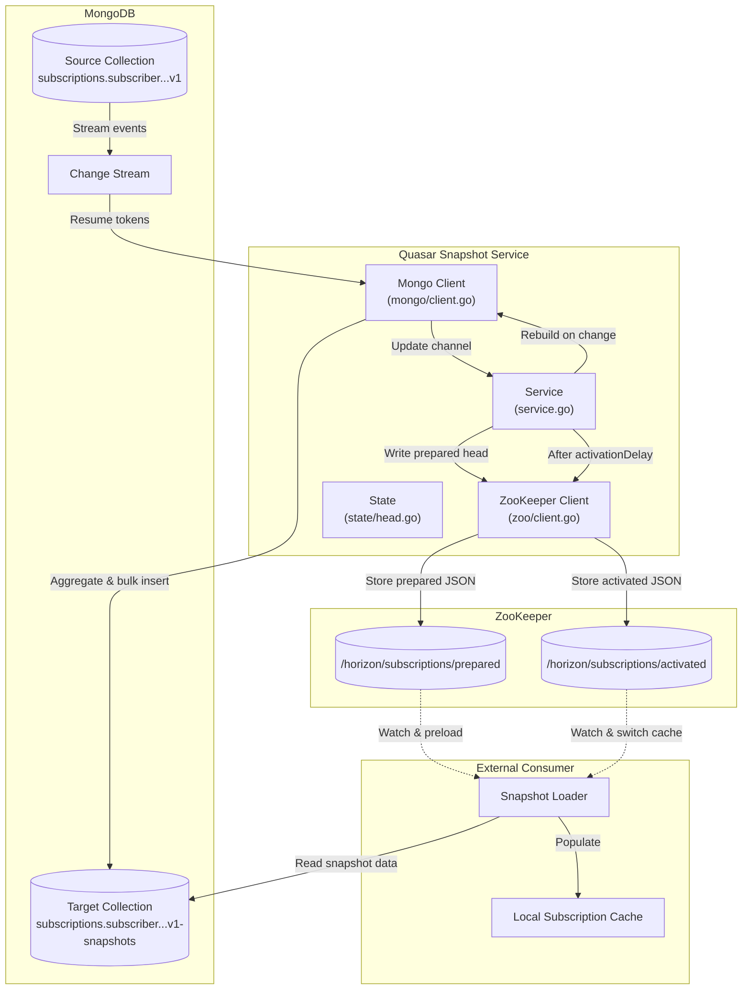
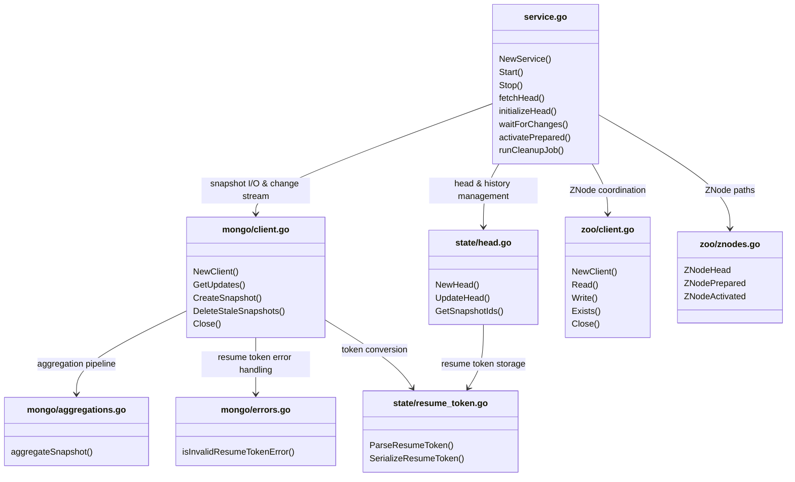
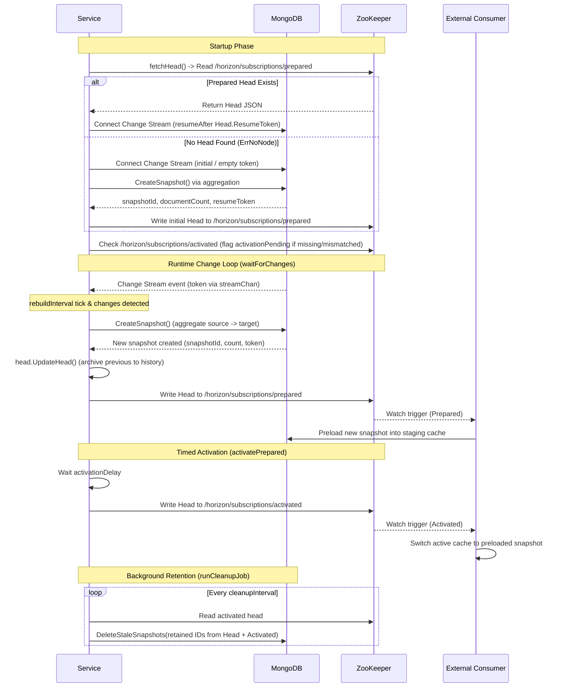

<!--
Copyright 2026 Deutsche Telekom AG

SPDX-License-Identifier: Apache-2.0
-->

# Subscription snapshots

## Architecture overview



The Quasar Snapshot Service provides point-in-time subscription snapshots stored in MongoDB and coordinated via Apache ZooKeeper:

1. **Change-Driven Triggering:** MongoDB Change Streams monitor mutations on the source collection (`subscriptions.subscriber.horizon.telekom.de.v1`). Stream resume tokens are received by the service to detect changes without polling or scanning entire collections.
2. **Snapshot Creation:** On each rebuild interval where changes are detected, Quasar executes a MongoDB aggregation pipeline that extracts, formats, and bulk-inserts all active subscriptions into the target collection (`subscriptions.subscriber.horizon.telekom.de.v1-snapshots`) under a unique `snapshotId`.
3. **Prepared Head Publication:** The snapshot metadata (`Head`) containing `snapshotId`, `documentCount`, `created`, `resumeToken`, and retained `history` is written to ZooKeeper at `/horizon/subscriptions/prepared`.
4. **Preloading & Activation Delay:** Consumers watching the `prepared` znode detect the new snapshot and preload the dataset into local staging caches. Quasar waits for a configurable `activationDelay`.
5. **Activated Head Publication:** After `activationDelay` elapses, the metadata is written to `/horizon/subscriptions/activated`. Consumers watching `activated` switch their active cache to the preloaded snapshot.
6. **Periodic Retention Cleanup:** A background job periodically collects active and historical snapshot IDs from both the in-memory head and the activated ZooKeeper node, deleting older, unreferenced snapshot documents from MongoDB.

## File and package overview

The snapshot functionality is organized under `internal/snapshot/` into distinct packages for service orchestration, MongoDB interactions, ZooKeeper coordination, and state management:



| File / Package | Responsibility |
| --- | --- |
| `internal/snapshot/service.go` | Orchestrates service lifecycle, starts the change listener, executes rebuild evaluation in `waitForChanges()`, handles timed activation in `activatePrepared()`, and schedules periodic cleanup via `runCleanupJob()`. |
| `internal/snapshot/state/head.go` | Defines the `Head` and `HistoryEntry` data structures, managing active snapshot metadata, history entry retention (up to 3 historical snapshots), and snapshot ID extraction (`GetSnapshotIds()`). |
| `internal/snapshot/state/resume_token.go` | Encapsulates the MongoDB Change Stream `ResumeToken` parsing, extraction, and string serialization. |
| `internal/snapshot/mongo/client.go` | Manages MongoDB connection, listens to Change Streams with automatic reconnection in `GetUpdates()`, creates snapshots in `CreateSnapshot()`, and purges stale snapshots in `DeleteStaleSnapshots()`. |
| `internal/snapshot/mongo/aggregations.go` | Defines the `aggregateSnapshot` aggregation pipeline stages mapping source subscription documents to target snapshot schema. |
| `internal/snapshot/mongo/errors.go` | Identifies invalid or expired resume token errors (codes 260, 280, 286) to enable resilient fallback handling. |
| `internal/snapshot/zoo/client.go` | Wrapper around `go-zookeeper` (`Shopify/zk`), providing recursive znode creation (`Write`), data reading (`Read`), and node verification (`Exists`). |
| `internal/snapshot/zoo/znodes.go` | Defines standard ZooKeeper paths (`ZNodeHead`, `ZNodePrepared`, `ZNodeActivated`). |

## Lifecycle



### Startup (`fetchHead` & `initializeHead`)

When the snapshot service starts (`Service.Start()`):

1. **Query Prepared Head:** The service calls `fetchHead()`, attempting to read the `/horizon/subscriptions/prepared` znode from ZooKeeper.
2. **First-time Initialization:** If the znode does not exist (`zk.ErrNoNode`), `initializeHead()` is invoked:
   - Connects the MongoDB Change Stream without a resume token (`GetUpdates(s.streamChan, nil)`).
   - Generates the baseline snapshot via `CreateSnapshot()`, obtaining an initial `snapshotId`, `documentCount`, and `resumeToken`.
   - Constructs a new `state.Head` and writes it to `/horizon/subscriptions/prepared`.
3. **Resuming Existing State:** If the prepared head exists, the JSON payload is unmarshaled into `s.head`, and `GetUpdates(s.streamChan, head.ResumeToken)` resumes the Change Stream from the stored resume token.
4. **Activation Verification:** The service checks `/horizon/subscriptions/activated`. If the node is missing or points to a different `snapshotId`, `s.activationPending` is flagged as `true`.
5. **Background Goroutines:** Spawns `waitForChanges(ctx)` for change detection and `runCleanupJob(ctx)` for snapshot retention management.

### Change detection and rebuild (`waitForChanges`)

The `waitForChanges()` loop monitors updates and creates snapshots at regular intervals:

1. **Change Stream Ingestion:** Whenever MongoDB emits a change event on the source collection, `mongo.Client.GetUpdates()` sends the updated `ResumeToken` over `s.streamChan`.
2. **Rebuild Interval Tick:** On each `rebuildInterval` ticker event:
   - Evaluates if changes occurred (`changesPresent == true` or `lastResumeToken.Value != head.ResumeToken.Value`).
   - If changes are present:
     - Executes `s.mongoClient.CreateSnapshot()` using the aggregation pipeline.
     - Invokes `s.head.UpdateHead(snapshotId, documentCount, newResumeToken)`: shifts the previous active head into the `history` array (retaining up to 3 previous entries) and updates the current head state.
     - Writes the updated `Head` JSON to `/horizon/subscriptions/prepared`.
     - Sets `s.activationPending = true` and resets `changesPresent = false`.
   - If `s.activationPending` is `true`:
     - Calls `s.activatePrepared()`.

### Activation delay (`activatePrepared`)

To prevent consumer downtime and cache inconsistency:

1. **Wait Period:** `activatePrepared()` waits for the configured `activationDelay` duration (e.g. 60 seconds).
2. **Publish Activated:** Writes the current `s.head` JSON to `/horizon/subscriptions/activated`.
3. **State Clear:** Clears `s.activationPending = false`.
4. **Consumer Cache Switch:** Consumers watching `activated` switch their live in-memory caches to the preloaded snapshot.

## ZNode and consumer contract

Default ZooKeeper znodes:
- `/horizon/subscriptions/prepared`
- `/horizon/subscriptions/activated`

Both znodes are persistent and contain the `Head` JSON payload structured as follows:

```json
{
  "snapshotId": "66fa911cb750798e27c1524f",
  "documentCount": 120,
  "created": "2026-09-30T15:00:00Z",
  "resumeToken": "8266FA911C000000012B...",
  "history": [
    {
      "snapshotId": "66fa8eecb750798e27c1524e",
      "documentCount": 115,
      "created": "2026-09-30T14:55:00Z"
    }
  ]
}
```

| Field | Type | Description |
| --- | --- | --- |
| `snapshotId` | String | 24-character hexadecimal MongoDB ObjectID string identifying the snapshot. |
| `documentCount` | Integer | Total count of subscription documents contained in this snapshot. |
| `created` | String | Creation timestamp formatted in UTC RFC3339 (e.g. `2026-09-30T15:00:00Z`). |
| `resumeToken` | String | String-serialized MongoDB Change Stream resume token matching the point in time of the snapshot. |
| `history` | Array | Retained history entries (up to 3 most recent previous snapshots), each with `snapshotId`, `documentCount`, and `created`. |

### MongoDB snapshot data

Snapshots are written to the target collection (`subscriptions.subscriber.horizon.telekom.de.v1-snapshots`). Each subscription document in the snapshot has the following structure:

```json
{
  "_id": { "$oid": "66fa911cb750798e27c15250" },
  "snapshotId": "66fa911cb750798e27c1524f",
  "subscriptionId": "sub-tenant-alpha-001",
  "resource": {
    "kind": "Subscription",
    "apiVersion": "subscriber.horizon.telekom.de/v1",
    "metadata": {
      "name": "sub-tenant-alpha-001"
    },
    "spec": {}
  }
}
```

- `_id`: Unique MongoDB `ObjectID` for this snapshot record.
- `snapshotId`: References the 24-character hexadecimal snapshot identifier in the ZooKeeper `Head`.
- `subscriptionId`: String ID matching the `_id` of the source subscription.
- `resource`: Full subscription object payload.

### Consumer integration flow

```text
Watch /horizon/subscriptions/prepared
  -> Preload documents matching snapshotId from target collection into staging cache
Watch /horizon/subscriptions/activated
  -> Switch live traffic to staging cache once activated snapshotId matches preloaded data
```

1. **Preload Phase:** When a new `Head` appears at `/horizon/subscriptions/prepared`, consumers read the snapshot documents from MongoDB with `snapshotId == Head.snapshotId` and populate an internal staging cache.
2. **Switch Phase:** When `/horizon/subscriptions/activated` is updated with the same `snapshotId`, consumers atomically swap active query routing to the preloaded cache.

## Retention and cleanup

The background cleanup routine runs every `snapshot.cleanupInterval` via `Service.runCleanupJob()`:

```text
Cleanup Tick -> Gather Retained Snapshot IDs (Head + Activated)
             -> Execute MongoDB DeleteMany where snapshotId not in retained IDs
```

1. **Retained ID Collection:**
   - Active and historical IDs from in-memory `s.head` (`head.GetSnapshotIds()`, including current `snapshotId` plus up to 3 `history` entries).
   - Active and historical IDs from the ZooKeeper `/horizon/subscriptions/activated` znode.
   - Retained IDs are merged to guarantee that neither actively queried nor recently activated versions are purged prematurely.
2. **Purge Execution:**
   - Executes MongoDB `DeleteMany` on the target collection with the filter:
     ```json
     { "snapshotId": { "$nin": [ "<retainedId1>", "<retainedId2>", ... ] } }
     ```
   - Logs the count of deleted stale documents.

## Configuration reference

All snapshot-related settings are located under the `snapshot` configuration prefix:

| Property | Environment Variable | Type | Default Value | Description |
| --- | --- | --- | --- | --- |
| `snapshot.enabled` | `QUASAR_SNAPSHOT_ENABLED` | `bool` | `false` | Enables the subscription snapshot service. |
| `snapshot.rebuildInterval` | `QUASAR_SNAPSHOT_REBUILDINTERVAL` | `duration` | `120s` | Interval between evaluations for change-stream-driven snapshot rebuilds. |
| `snapshot.activationDelay` | `QUASAR_SNAPSHOT_ACTIVATIONDELAY` | `duration` | `60s` | Delay between writing `prepared` and `activated` znodes to allow consumer cache preloading. |
| `snapshot.cleanupInterval` | `QUASAR_SNAPSHOT_CLEANUPINTERVAL` | `duration` | `300s` | Interval between background snapshot retention cleanup executions. |
| `snapshot.mongo.uri` | `QUASAR_SNAPSHOT_MONGO_URI` | `string` | `mongodb://localhost:27017,localhost:27018,localhost:27019/?replicaSet=rs0` | MongoDB connection URI (must connect to a replica set for Change Streams). |
| `snapshot.mongo.database` | `QUASAR_SNAPSHOT_MONGO_DATABASE` | `string` | `horizon-config` | MongoDB database name. |
| `snapshot.mongo.sourceCollection` | `QUASAR_SNAPSHOT_MONGO_SOURCECOLLECTION` | `string` | `subscriptions.subscriber.horizon.telekom.de.v1` | Source collection storing active subscriptions. |
| `snapshot.mongo.targetCollection` | `QUASAR_SNAPSHOT_MONGO_TARGETCOLLECTION` | `string` | `subscriptions.subscriber.horizon.telekom.de.v1-snapshots` | Target collection storing generated snapshot documents. |
| `snapshot.mongo.reconnectInterval` | `QUASAR_SNAPSHOT_MONGO_RECONNECTINTERVAL` | `duration` | `10s` | Reconnect retry interval for MongoDB Change Stream listener. |
| `snapshot.zookeeper.addresses` | `QUASAR_SNAPSHOT_ZOOKEEPER_ADDRESSES` | `[]string` | `["localhost:2181", "localhost:2182", "localhost:2183"]` | ZooKeeper ensemble server addresses (`host:port`). |
| `snapshot.zookeeper.sessionTimeout` | `QUASAR_SNAPSHOT_ZOOKEEPER_SESSIONTIMEOUT` | `duration` | `10s` | ZooKeeper session timeout. |

## Logging reference

The snapshot service uses `rs/zerolog` with structured loggers:

| Logger | Level | Event / Message | Description |
| --- | --- | --- | --- |
| `snapshot` | `INFO` | `no existing head found, creating initial snapshot` | Initial startup when no prepared znode exists in ZooKeeper. |
| `snapshot` | `INFO` | `existing head found` | Startup recovery resuming from existing prepared head in ZooKeeper. |
| `snapshot` | `INFO` | `changes detected, creating new snapshot` | Change Stream detected mutations; aggregation pipeline started. |
| `snapshot` | `INFO` | `prepared head updated` | New snapshot metadata successfully published to `/horizon/subscriptions/prepared`. |
| `snapshot` | `DEBUG` | `waiting for activation delay to pass` | Activation delay countdown initiated. |
| `snapshot` | `INFO` | `activated head updated` | Snapshot metadata successfully published to `/horizon/subscriptions/activated`. |
| `snapshot` | `DEBUG` | `resumeToken updated` | New Change Stream token received from MongoDB. |
| `snapshot` | `DEBUG` | `no changes therefore skipping snapshot creation` | Rebuild tick elapsed with no change stream events. |
| `snapshot` | `DEBUG` | `cleaned up stale snapshots` | Completed periodic retention job and purged unreferenced snapshots. |
| `mongo` | `WARN` | `attempting to reconnect change stream` | Change Stream encountered an error and is reconnecting. |
| `mongo` | `ERROR` | `failed to create snapshot` / `change stream error` | Aggregation or change stream failure. |
| `zoo` | `ERROR` | `failed to read/write znode` | ZooKeeper communication failure. |

## Operation and development

- **Single Active Instance:** Quasar runs the snapshot engine as a background worker when `snapshot.enabled` is `true`.
- **Change Stream Requirements:** MongoDB must be deployed as a replica set or sharded cluster with Change Streams enabled.
- **ZooKeeper Node Initialization:** Quasar automatically ensures parent paths and nodes exist using recursive znode creation.
- **Testing:** Unit and integration tests reside in `internal/snapshot/` and `internal/snapshot/mongo/`. Dockertest fixtures can be used for integration verification against live MongoDB and ZooKeeper instances.